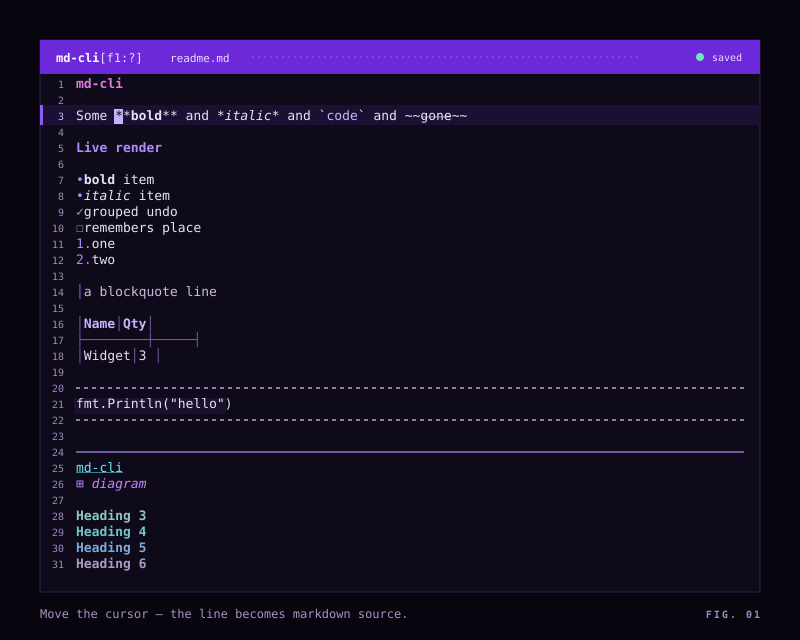

<div align="center">

# md-cli

### The markdown editor that shows the page, not the code.

Live-rendered markdown in your terminal. One pane. No preview window. No mouse.



`go install github.com/z-d-g/md-cli/v2/cmd/md-cli@latest`

[](https://go.dev)
[](https://github.com/z-d-g/md-cli/actions/workflows/ci.yml)
[](https://github.com/z-d-g/md-cli/releases/latest)
[](https://codecov.io/github.com/z-d-g/md-cli)
[](LICENSE)

</div>

---

## The problem

Every markdown editor gives you two panes. Source on the left, preview on the
right. You scroll both. You lose your place.

md-cli uses **one** pane. It renders what it can and shows raw markdown exactly
where your cursor sits. Move away and the syntax fades. Move back and it returns.

```
  You type              You move away
  ─────────             ─────────────
  1 ## Hello        →   1 Hello
  2 Some **bold**       2 Some bold
  3                     3
```

## Quick start

```bash
go install github.com/z-d-g/md-cli/v2/cmd/md-cli@latest

md-cli notes.md            # edit
md-cli -p notes.md         # print to stdout
cat notes.md | md-cli -p   # print from stdin
```

Build from source with `make install` (default prefix `~/.local`).

## What you get

| Feature | What it does |
|---|---|
| **Live render** | Headings, bold, italic, underline, strike, code, links, tables, lists, images. |
| **Cursor-aware** | The block under your cursor turns into raw markdown. |
| **Real editing** | Shift-select, word and line ops, copy, cut, paste, undo, redo. |
| **Grouped undo** | One `Ctrl+Z` undoes a word, not a letter. |
| **Remembers place** | Cursor restored per file from `~/.cache/md-cli/`. |
| **Print mode** | `md-cli -p` renders to stdout, ready to pipe or redirect. |
| **Unicode** | CJK, emoji and combining marks. Long lines clip, never wrap. |
| **Single binary** | No CGO, no config, no runtime dependencies. |

## Keys

| Key | Action |
|---|---|
| `Ctrl+S` | Save |
| `Ctrl+Q` | Quit |
| `F1` | All keys |

## Exit codes

| Code | Means |
|---|---|
| `0` | Success |
| `1` | Runtime failure |
| `2` | Usage error |

## Built with

[Bubble Tea](https://github.com/charmbracelet/bubbletea) v2 ·
[Lip Gloss](https://github.com/charmbracelet/lipgloss) v2 ·
[goldmark](https://github.com/yuin/goldmark) v2 ·
[x/ansi](https://github.com/charmbracelet/x)

## More

[Architecture](docs/INDEX.md) ·
[Releases](https://github.com/z-d-g/md-cli/releases) ·
[Contributing](CONTRIBUTING.md) ·
[Issues](https://github.com/z-d-g/md-cli/issues) ·
[MIT](LICENSE)
